<p align="center">
  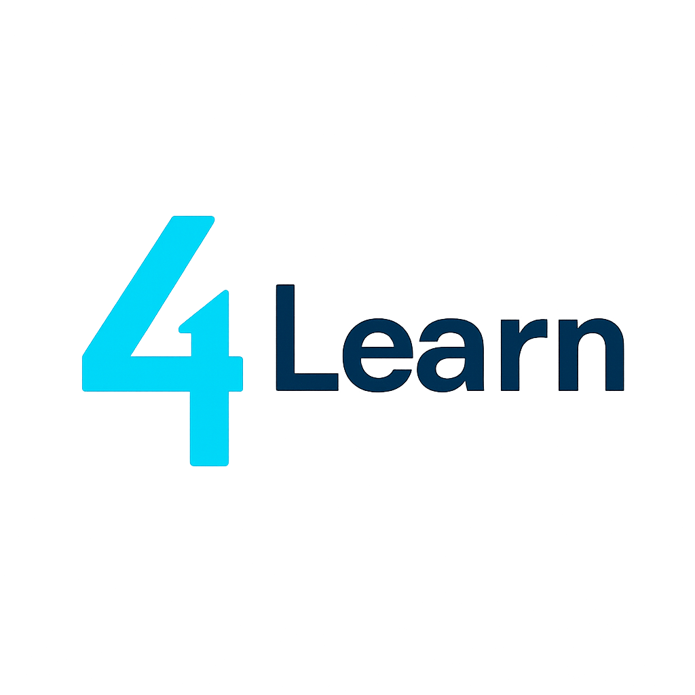
</p>

<h1 align="center">do4learn (4Learn)</h1>

<p align="center">
  <strong>Democratizing Higher Education through Real-Time Pedagogical Analytics, Personalized Learning Profiling, Structured Research Mentorship, and Conversational AI.</strong>
</p>

<p align="center">
  <a href="https://do4learn.web.app/"></a>
  <a href="https://flutter.dev/"></a>
  <a href="https://dart.dev/"></a>
  <a href="https://firebase.google.com/"></a>
  <a href="#"></a>
  <a href="#"></a>
</p>

---

## 📌 Executive Summary

**do4learn** (also known as **4Learn**) is a zero-cost, cross-platform educational ecosystem built with Flutter and Firebase. Engineered for both modern Web browsers and Android mobile devices, do4learn addresses critical bottlenecks in global higher education: **delayed feedback loops**, **one-size-fits-all instructional delivery**, **high postgraduate thesis attrition rates**, and **prohibitive licensing costs** of traditional Learning Management Systems (LMS).

By synthesizing **evidence-based learning sciences**, **formative micro-evaluations**, **metacognitive learning style diagnostics**, a **rigorous 8-phase graduate thesis tracker**, and an **integrated conversational AI tutor**, do4learn provides an equitable, scalable, and data-informed academic operating environment for educational institutions worldwide.

🌐 **Try the Live Web Platform:** [https://do4learn.web.app/](https://do4learn.web.app/)  
📱 **Android App:** Optimized mobile experience with in-app APK auto-update capabilities.

---

## 🎯 Key Differentiators

| Dimension | Traditional LMS & Academic Portals | **do4learn Platform** |
| :--- | :--- | :--- |
| **Pedagogical Alignment** | Summative assessments delivered weeks after instruction. | **Real-Time Formative Feedback**: Instant pulse-checks and sentiment tracking for rapid instructional iteration. |
| **Cognitive Personalization** | Uniform syllabi ignoring learner differences. | **Metacognitive Profiling**: Self-directed learning diagnostics informing adaptive teaching methodologies. |
| **Graduate Research Support** | Unstructured, sporadic thesis advising leading to high ABD (*All But Dissertation*) dropouts. | **8-Phase Weighted Thesis Lifecycle**: Milestone-driven dissertation monitoring with ethical AI compliance and verification. |
| **AI Integration & Ethics** | Generic third-party chatbots with hallucination risks. | **Role-Aware Conversational Assistant**: Context-bound, role-specific guidance with explicit academic ethics checkpoints. |
| **Equity & Inclusivity** | Costly per-seat licenses; monolingual interfaces. | **100% Free & Open Access**: Zero-cost barrier; natively localized into **12 languages** covering >4B native speakers. |
| **Technical Scalability** | Heavy, monolithic infrastructure requiring local IT teams. | **Serverless Reactive Cloud Architecture**: Multiplatform Flutter front-end backed by Firebase Cloud Firestore and Auth. |

---

## 🚀 Core Pillars & Pedagogical Innovations

### 1. ⚡ Real-Time Formative Micro-Feedback Loop
Traditional end-of-semester course evaluations arrive too late to benefit the cohort providing the feedback. do4learn implements lightweight, low-friction micro-evaluations:
- **Zero Survey Fatigue:** Instantaneous rating scales, mood/sentiment indicators, and recommendation metrics.
- **Actionable Agility:** Faculty and academic administrators detect instructional hurdles in real-time, allowing immediate curricular and pedagogical adjustments.
- **Visual Analytics:** Instant aggregate visual reports powered by high-performance interactive charts.

### 2. 🧠 Metacognitive & Personalized Learning Profiles
Grounded in contemporary learning sciences, do4learn empowers students to evaluate and declare their cognitive learning profiles for every enrolled course:
- **Diagnostic Categories:** Information source preferences, study tools, cognitive styles, collaboration/sharing habits, and feedback receptivity.
- **Differentiated Instruction:** Equips educators with cohort-level learning profiles, enabling targeted instructional interventions, multimedia adaptations, and diversified task designs.

### 3. 🔬 Comprehensive 8-Phase Thesis & Research Mentorship Engine
Graduate and undergraduate dissertation completion suffers from lack of transparent structure and milestone visibility. do4learn introduces an end-to-end, weighted thesis governance pipeline:

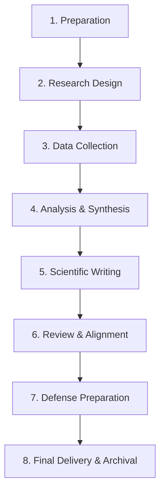

- **Phase 1: Preparation:** Modality selection, research schedule, scientific databases, reference managers, backup/version control, and **explicit ethical AI boundaries**.
- **Phase 2: Research Design:** Problem justification, research questions, theoretical framework, methodology, budget, and impact assessment.
- **Phase 3: Data Collection:** Ethics/IRB permissions, protocol execution, data organization, and hygiene verification.
- **Phase 4: Analysis & Synthesis:** Statistical and qualitative testing, specialized software use, data interpretation, and constraint analysis.
- **Phase 5: Scientific Writing:** Academic formatting, introduction, thematic chapters, bibliography completion, and grammatical rigor.
- **Phase 6: Committee Review:** Objective verification, conclusion alignment, and advisory sign-offs.
- **Phase 7: Oral Defense:** Defense rehearsals, slide synthesis, and committee question preparation.
- **Phase 8: Final Delivery:** Evaluation review, rubric fulfillment, and institutional archiving.
- **Algorithmic Progress Weighting:** Automated calculation of weighted progress across all milestones for transparent advisor-advisee alignment.

### 4. 🤖 Role-Aware Conversational AI Assistant
Integrated directly into the mobile and web interfaces, an intelligent assistant provides seamless 24/7 support:
- **Role-Aware Contextual Dispatch:** Answers adapt automatically based on the user's role—Manager, Professor, or Student.
- **Zero-Friction Onboarding:** Minimizes technical hurdles and navigation barriers without forcing users through static documentation.
- **Ethical Academic Guardrails:** Reinforces platform best practices and academic integrity.

### 5. 🌍 Radical Accessibility & Global Inclusion
To advance **UN Sustainable Development Goal 4 (Quality Education)** and **Goal 10 (Reduced Inequalities)**, do4learn eliminates geographical, linguistic, and financial barriers:
- **12 Fully Supported Languages:**
  - 🇺🇸 English (`en`) &nbsp;|&nbsp; 🇪🇸 Spanish (`es`) &nbsp;|&nbsp; 🇫🇷 French (`fr`) &nbsp;|&nbsp; 🇩🇪 German (`de`)
  - 🇨🇳 Chinese (`zh`) &nbsp;|&nbsp; 🇯🇵 Japanese (`ja`) &nbsp;|&nbsp; 🇮🇳 Hindi (`hi`) &nbsp;|&nbsp; 🇧🇩 Bengali (`bn`)
  - 🇮🇹 Italian (`it`) &nbsp;|&nbsp; 🇵🇹 Portuguese (`pt`) &nbsp;|&nbsp; 🇷🇺 Russian (`ru`) &nbsp;|&nbsp; 🇸🇦 Arabic (`ar`)
- **Cost-Free:** 100% free with no hidden paywalls, freemium tiers, or institutional license fees.
- **Cross-Device Continuum:** Identical synchronized state across web browsers and budget Android devices.

---

## 👥 Role-Based Access Control (RBAC) Matrix

do4learn organizes institutional workflows into three clearly separated user tiers:

| Functional Area | Platform Capability | Manager (Admin) | Professor (Faculty) | Student (Learner) |
| :--- | :--- | :---: | :---: | :---: |
| **Profile** | Identity & preferences management (Email & Google Auth) | ✅ | ✅ | ✅ |
| **Institutions** | Create, configure, and manage universities / campuses | ✅ | ❌ | ❌ |
| **Faculty Ops** | Onboard, assign, and audit professors | ✅ | ❌ | ❌ |
| **Courses** | Create and configure academic courses | ✅ | ✅ | ❌ |
| **Enrollment** | Generate unique enrollment codes and approve rosters | ✅ | ✅ | ❌ |
| **Course Access**| Register and join courses via institutional codes | ❌ | ❌ | ✅ |
| **Activities** | Design, schedule, and assign learning activities | ✅ | ✅ | ❌ |
| **Participation**| Submit feedback, learning profiles, and thesis progress | ❌ | ❌ | ✅ |
| **Analytics** | View real-time visual summaries, charts, and export CSVs | ✅ | ✅ | ❌ |
| **AI Support** | Contextual AI chat tailored to role requirements | ✅ | ✅ | ✅ |

---

## 📸 Platform Interface & Visual Analytics

### 1. Onboarding, Identity & Course Management
<p align="center">
  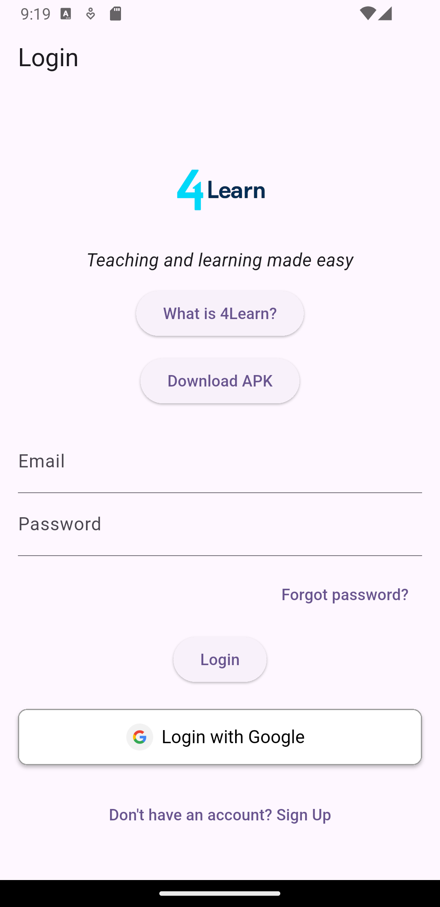
  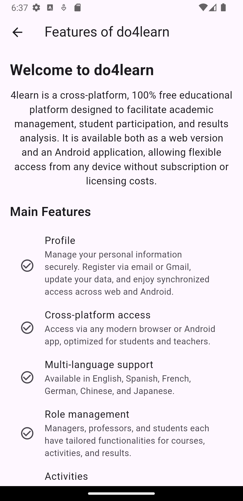
  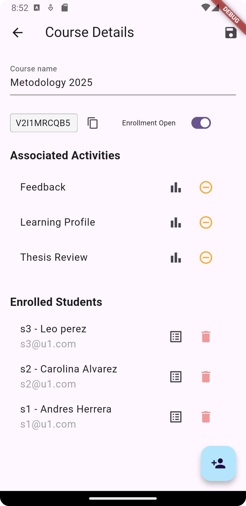
  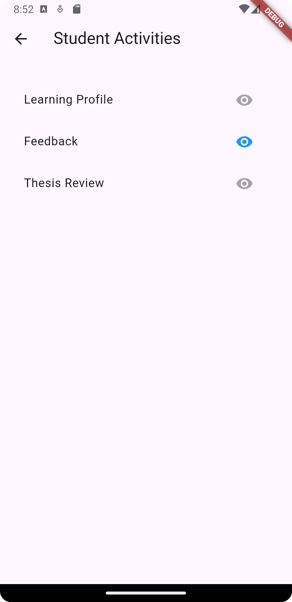
</p>
<p align="center">
  <em>(1) Secure Authentication & Role Login &nbsp;|&nbsp; (2) Welcome & Platform Overview &nbsp;|&nbsp; (3) Course Management & Controls &nbsp;|&nbsp; (4) Student Activities Workspace</em>
</p>

### 2. Pedagogical Assessment & Dissertation Governance
<p align="center">
  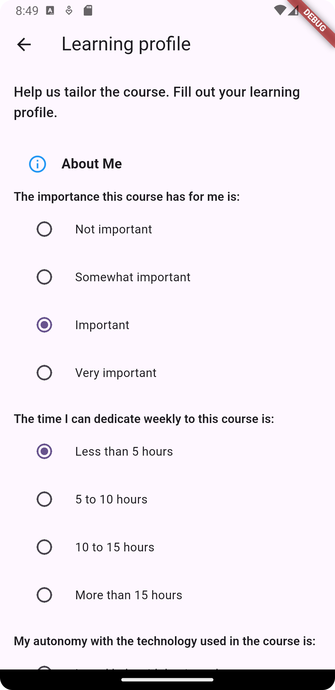
  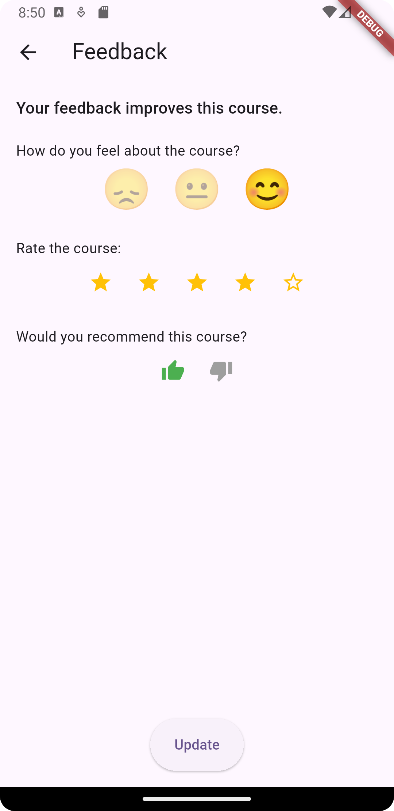
  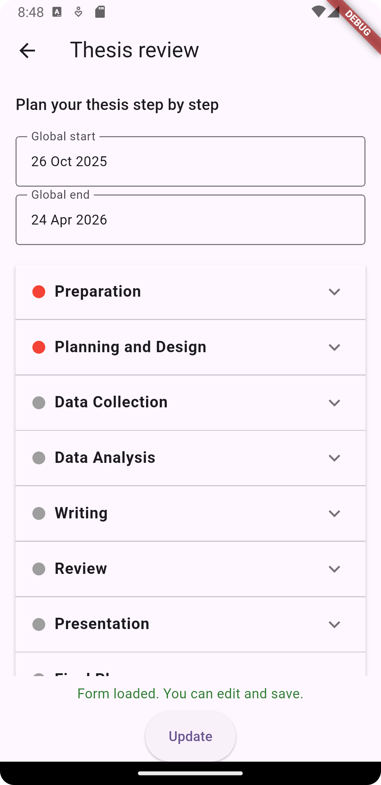
  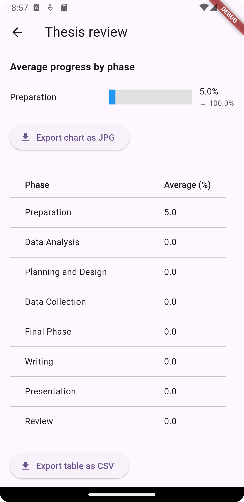
</p>
<p align="center">
  <em>(5) Metacognitive Learning Profile Diagnostic &nbsp;|&nbsp; (6) Real-Time Formative Micro-Feedback &nbsp;|&nbsp; (7) 8-Phase Structured Thesis Tracker &nbsp;|&nbsp; (8) Thesis Visual Analytics Summary</em>
</p>

---

## 🏗️ Technical Architecture & System Design

do4learn leverages a reactive, decoupled, serverless architecture that guarantees real-time synchronization, high availability, and minimal operational overhead.

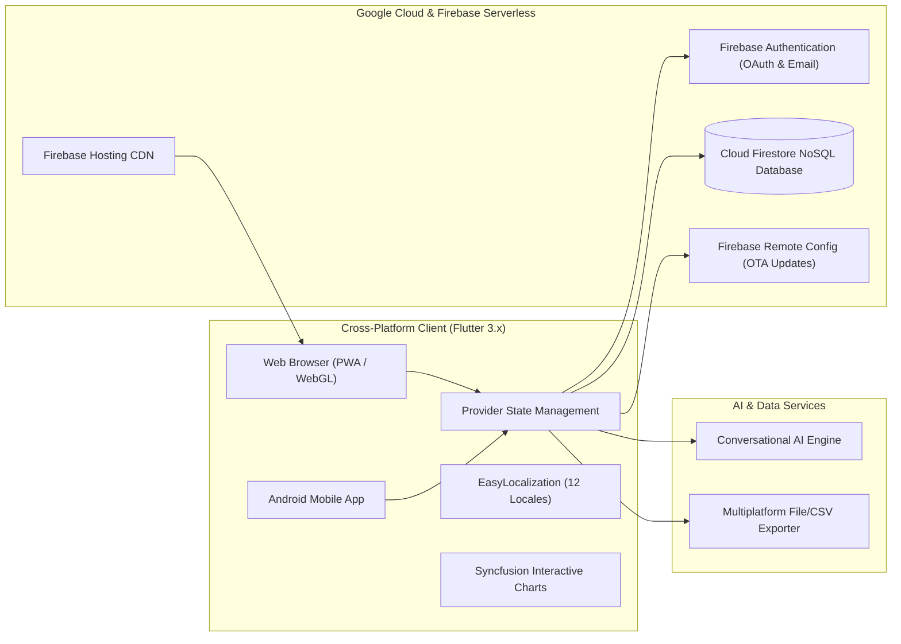

### Key Technologies & Libraries

- **Application Framework:** [Flutter](https://flutter.dev/) (SDK `^3.9.2`) & [Dart](https://dart.dev/)
- **State Management:** [`provider: ^6.1.2`](https://pub.dev/packages/provider) for clean, reactive separation of concerns.
- **Authentication:** [`firebase_auth: ^6.1.0`](https://pub.dev/packages/firebase_auth) & [`google_sign_in: ^6.1.4`](https://pub.dev/packages/google_sign_in).
- **Database:** [`cloud_firestore: ^6.0.2`](https://pub.dev/packages/cloud_firestore) utilizing real-time snapshots and indexed collections.
- **Dynamic Configuration & Updates:** [`firebase_remote_config: ^6.0.2`](https://pub.dev/packages/firebase_remote_config).
- **Internationalization:** [`easy_localization: ^3.0.5`](https://pub.dev/packages/easy_localization) managing JSON asset translation catalogs.
- **Data Visualization:** [`syncfusion_flutter_charts: ^31.1.22`](https://pub.dev/packages/syncfusion_flutter_charts) for academic dashboards.
- **Conversational AI:** [`dialog_flowtter`](https://pub.dev/packages/dialog_flowtter) integrating Google Dialogflow Natural Language Understanding.
- **Data Interoperability:** Platform-adaptive file exporter ([`file_exporter_web.dart`](lib/utils/file_exporter_web.dart) with HTML5 Blobs, [`file_exporter_stub.dart`](lib/utils/file_exporter_stub.dart) with [`path_provider`](https://pub.dev/packages/path_provider) and [`csv`](https://pub.dev/packages/csv)).

---

## 🏛️ Pedagogical Foundations, Research Framework & UN SDGs

### 1. UN Sustainable Development Goals (SDGs)
- **SDG 4: Quality Education (Targets 4.3 & 4.c):** By offering a zero-cost academic management and research governance infrastructure, do4learn empowers universities in emerging economies to implement international pedagogical standards without proprietary software budgets.
- **SDG 10: Reduced Inequalities (Target 10.2):** 12-language localization and cross-device optimization dismantle socio-linguistic and hardware barriers.

### 2. Pedagogical Evidence Base
- **Hattie's Visible Learning:** Feedback has an effect size of $d = 0.73$ on student achievement. do4learn's micro-feedback accelerates formative loops to hours instead of months.
- **Metacognition and Self-Regulated Learning (Zimmerman & Flavell):** Providing students with explicit reflection on their learning profile reinforces self-regulatory study habits.
- **Scaffolding and Deliberate Practice (Ericsson & Vygotsky):** The 8-phase thesis model decomposes complex multi-year research projects into achievable, measurable cognitive milestones.

### 3. Ethical AI & Scientific Rigor
- The thesis review module explicitly enforces research integrity through the **"Ethical Use of AI"** milestone, requiring scholars to document prompt engineering, verification protocols, and generative AI boundaries before empirical data collection.

---

## 🛠️ Getting Started & Local Development

### Prerequisites

- [Flutter SDK](https://docs.flutter.dev/get-started/install) (version `>= 3.9.2`)
- [Dart SDK](https://dart.dev/get-dart)
- An active [Firebase Project](https://console.firebase.google.com/) with Authentication, Firestore, and Remote Config enabled.
- Google Chrome (for web development) or Android Studio / physical Android device.

### Installation

1. **Clone the repository:**
   ```bash
   git clone https://github.com/mathiascar7/do4learn.git
   cd do4learn
   ```

2. **Install Flutter dependencies:**
   ```bash
   flutter pub get
   ```

3. **Configure Firebase:**
   - Configure Firebase CLI via FlutterFire:
     ```bash
     dart pub global activate flutterfire_cli
     flutterfire configure
     ```
   - Ensure `lib/firebase_options.dart` and `assets/dialog_flow_auth.json` are properly linked.

4. **Run on Web:**
   ```bash
   flutter run -d chrome
   ```

5. **Run on Android:**
   ```bash
   flutter run -d android
   ```

### Building for Production

- **Web Build:**
  ```bash
  flutter build web --release
  firebase deploy --only hosting
  ```
- **Android APK:**
  ```bash
  flutter build apk --release --split-per-abi
  ```

---

## 📂 Project Directory Structure

```text
four_learn/
├── assets/
│   ├── images/               # Pedagogical module screenshots & UI assets
│   ├── langs/                # 12 localization JSON translation files (en, es, zh, ar, etc.)
│   ├── 4learn_logo.png       # Platform visual identity
│   └── dialog_flow_auth.json # Dialogflow conversational engine credentials
├── lib/
│   ├── forms/                # Pedagogical instrument forms
│   │   ├── feedback_form_page.dart # Real-time course feedback form
│   │   ├── profile_form_page.dart  # Learning style & preference diagnostics
│   │   ├── style_form_page.dart    # Micro-rating and recommendation form
│   │   └── thesis_form_page.dart   # 8-Phase weighted thesis tracking instrument
│   ├── screens/              # Core application screens (Home, Auth, Courses, Admin)
│   │   ├── about_page.dart         # Interactive platform documentation
│   │   ├── chat_screen.dart        # AI conversational assistant interface
│   │   ├── course_management_page.dart
│   │   └── university_management_page.dart
│   ├── services/             # Core business logic & authentication services
│   │   └── auth_service.dart       # RBAC & Firebase Authentication handling
│   ├── summaries/            # Visual analytics, charts, and aggregate reports
│   │   ├── feedback_summary_page.dart
│   │   ├── profile_summary_page.dart
│   │   └── thesis_summary_page.dart
│   ├── utils/                # Interoperability tools & platform-adaptive exporters
│   │   ├── file_exporter_web.dart  # Web Blob CSV file generation
│   │   └── file_exporter_stub.dart # Mobile native CSV file generation
│   ├── firebase_options.dart # Generated Firebase configuration
│   └── main.dart             # Application root, routing, theme, and locale setup
├── pubspec.yaml              # Package dependencies, assets, and metadata
└── README.md                 # Project documentation
```

---

## 🔮 Strategic Roadmap & Research Horizons

- [ ] **LTI 1.3 / OneRoster Interoperability:** Seamless integration with Canvas, Blackboard, and Moodle.
- [ ] **Adaptive AI Recommendations:** Machine-learning recommendations matching students' learning profiles with personalized Open Educational Resources (OER).
- [ ] **Predictive Thesis Milestones:** Early-warning predictive analytics identifying student stagnation in research phases before committee deadlines.
- [ ] **Offline-First Synchronization:** Local SQLite caching for rural and intermittent-connectivity educational environments.


---

## 📬 Contact & Academic Collaboration

For institutional pilots, academic partnerships, or research inquiries:

- **Official Web Platform:** [https://do4learn.web.app/](https://do4learn.web.app/)
- **Contact Email:** [do4learn@gmail.com](mailto:do4learn@gmail.com)
- **Institution:** Global Educational Access Initiative

---

<p align="center">
  <sub>Built with purpose for students, educators, and researchers worldwide.</sub>
</p>
